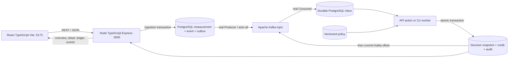

# Connectivity Credits

A runnable operations console with a **Node.js/TypeScript/Express backend, React/TypeScript/Vite UI, PostgreSQL persistence, REST/JSON API and real Node Kafka producers/consumers**. It uses **Kenya, Nepal and Rwanda as example country labels**, with 12 fictional schools, three fictional providers and 14 days of synthetic readings. Every school, provider, reading and credit is demo data; the country labels do not imply a deployment or measured national performance. The same policy applies to every country, and country does not enter eligibility checks. PostgreSQL stores measurements, decisions, credits and the Kafka outbox/inbox. Container and CI configuration are included.

**Independent prototype · Synthetic data.** This project is not affiliated with or approved by UNICEF or Giga. Verification is a supplied demo field, credits have no monetary value, and no payment, token or blockchain transaction occurs. Seeded totals demonstrate software behavior; they are not evidence of schools connected or real-world impact.

## Run with real Kafka

Requirements: **Node.js 22.16+** with npm, PostgreSQL 16+ server binaries, `curl` and a macOS/Linux terminal. The tested runtimes are **Node.js 24.19.0** and the installed **PostgreSQL 16.2**. Native service helpers and independent QA tools additionally use Python 3.11+; Python does not run the application backend. The first run downloads approximately 183 MB of official Java/Kafka archives on Apple silicon. No global installation is performed. Set `PG_BIN` if PostgreSQL binaries are outside PATH; the Mac helper recognizes `/Library/PostgreSQL/16/bin`.

```bash
cd /path/to/connectivity-credits-demo
./scripts/start-kafka.sh
```

Open **[localhost:5173](http://127.0.0.1:5173)** and confirm **Kafka connected**. The launcher starts task-owned PostgreSQL on `127.0.0.1:5433`, a real KRaft broker on `127.0.0.1:19092`, builds the Node lockfiles/TypeScript projects, then starts **Express on port 3000** plus **Vite on port 5173**. Vite proxies `/api` to Express. The built UI is also available from [localhost:3000](http://127.0.0.1:3000). New worker actions publish to Kafka and consume broker records before evaluating decisions.

The broker bootstrap downloads **Apache Kafka 4.4.0** and **Eclipse Temurin JRE 21.0.13+9**, verifies official SHA512/SHA256 checksums, and extracts them under `.data/runtime`. Broker state is in `.data/kafka`. PostgreSQL data is in `.data/postgres/cluster`; generated credentials are private 0600 files in `.data/postgres`. The app uses a non-superuser role with SCRAM password authentication. The helper uses port 5433 and does not manage other PostgreSQL instances. Restarting does not reset data. Download origins/hashes are in [runtime-downloads.json](artifacts/kafka/runtime-downloads.json); see [Kafka Java support](https://kafka.apache.org/44/operations/java-version/), [Apache downloads](https://kafka.apache.org/community/downloads/) and the [Temurin release](https://github.com/adoptium/temurin21-binaries/releases/tag/jdk-21.0.13%2B9).

Ctrl+C stops the owned Express/Vite children and any service instance newly started by that launch. Pre-existing services are retained. Explicit task-owned service controls are:

```bash
./scripts/kafka-local.sh stop
./scripts/postgres-local.sh stop
```

Data and credentials are retained. Both helpers accept `status` and verify PID/data-path ownership before stopping anything. PostgreSQL listens only on localhost:5433; no installed service/configuration is modified. The active app reads `DATABASE_URL` privately from `.data/postgres/app.env`; credentials are never printed by the helpers or committed to source.

Runtime discovery skips an older system Node (the local default is Node 18) and recognizes the compatible Codex bundled runtime when available. To choose your own installations:

```bash
NODE_BIN=/absolute/path/to/node24 PYTHON_BIN=/absolute/path/to/python3.12 ./scripts/start-kafka.sh
```

`NPM_BIN` can specify the npm executable. The launcher refuses occupied app ports and leaves existing services untouched; stop an earlier demo launch before starting another copy.

After the first setup, the already-built app can run without reinstalling dependencies. Start the broker, then the API:

```bash
./scripts/kafka-local.sh start
./scripts/postgres-local.sh start
source .data/postgres/app.env
CONNECTIVITY_TRANSPORT=kafka node server/dist/index.js
```

For separate development terminals, run the API command above, then `cd frontend && npm run dev`. Vite serves [localhost:5173](http://127.0.0.1:5173) and proxies `/api` to port 3000. These servers bind to localhost. Use a supported Node binary for manual commands as well.

For **broker-free mode**, run `CONNECTIVITY_TRANSPORT=local ./scripts/start.sh`. It still uses PostgreSQL for the durable event queue and is labeled **Local queue active**. Kafka mode never silently switches during an outage; a missing broker produces HTTP 503 while preserving work.

## Current stack and scope

| Area | Concrete implementation and review evidence |
| --- | --- |
| Node backend | Express 5, TypeScript, Zod validation and async `pg` pools in `server/`; pinned npm lockfile and Node 22.16+ requirement. |
| TypeScript UI | React/TypeScript console in `frontend/`; strict type checking and Vite build. |
| REST/JSON | Measurement ingestion, rules, worker, retry and ledger endpoints under `/api`; JSON validation/error responses. |
| Kafka event processing | Real native Node Kafka Producer/Consumer, broker delivery acknowledgements, durable outbox/inbox and explicit consumer-offset commits; independent actual-broker record/offset tests. |
| Containerization | Multistage `Dockerfile` and Compose for Express + PostgreSQL + Kafka, plus an optional worker. GitHub Actions passed image/configuration validation and the public-demo stack's end-to-end issuance, duplicate and rollback/retry checks. |
| Tests and CI | Native Node tests, independent HTTP/browser checks against spawned Express processes, real Kafka tests and `.github/workflows/ci.yml`. See [remote CI evidence](VALIDATION.md#container-and-ci-validation) for executed checks and current status. |
| Rules and audit | Versioned policy snapshots, atomic decision/credit/audit completion, failure injection and safe retry. |
| Persistence | Actual PostgreSQL transactions, uniqueness constraints and session advisory worker locks; SQLite remains only a read-only migration source/historical reference. |
| Verification and transfer | Synthetic measurements and supplied simulated verification status; integer demo credits only, with no real transfer integration. |

This is the prototype's implementation stack. It does not claim that the JD mandates Node or PostgreSQL, nor that this is a production deployment or official UNICEF acceptance. This repository contains the active TypeScript application. Earlier development implementations are excluded.

## Containers

With Docker/Compose installed, stop task-owned services using ports 3000/5433/19092, then prepare private generated credentials (this command needs no host PostgreSQL binaries) and run:

```bash
./scripts/postgres-local.sh credentials
docker compose --env-file .data/postgres/compose.env up --build
```

Open [localhost:3000](http://127.0.0.1:3000). Express binds to `0.0.0.0` inside the container, waits for PostgreSQL/Kafka health and uses internal service addresses. Only localhost host ports are published. Named volumes retain PostgreSQL and broker data. Add `--profile background-worker` to also start the continuous consumer; that may process events before guided UI actions. Use the same `--env-file` with `down` to stop containers; `down --volumes` also deletes this Compose project's data.

The files follow Apache's [official Kafka Docker configuration examples](https://github.com/apache/kafka/blob/trunk/docker/examples/docker-compose-files/single-node/plaintext/docker-compose.yml). Docker is unavailable on the development machine. GitHub Actions builds and runs the public-demo Compose stack, including the business-flow smoke checks in `scripts/hosted-smoke.mjs`. See the [CI record](VALIDATION.md#container-and-ci-validation).

### Hosted sandbox with Coolify

The [public demo](https://connectivity.ankitpasayat.com/) uses `compose.coolify.yml` from the `main` branch. Configure the API service's HTTPS domain to forward to internal port 3000. The Compose file publishes no host ports for PostgreSQL or Kafka. Coolify generates `SERVICE_PASSWORD_64_ADMIN` and `SERVICE_PASSWORD_64_APP`; do not commit or print their values. `Dockerfile.postgres` packages the initialization script inside the database image, avoiding Coolify's relocation of relative bind mounts. PostgreSQL initializes a separate, non-superuser application role. Persistent volumes retain the database and broker state across redeploys.

`CONNECTIVITY_PUBLIC_DEMO=true` enables a shared-sandbox banner and bounded writes: one active mutation, a global burst of eight writes refilling at 20 per minute, separate reset limits, a 5,000-row budget with recovery headroom, and a 50-event worker batch limit. Health probes are coalesced and cached for five seconds. These process-local controls assume one API instance; they are not authentication or a distributed abuse-control system. Every visitor shares the same synthetic data, policy and reset button.

Container memory limits are 256 MiB for PostgreSQL, 768 MiB for Kafka and 384 MiB for the API. Kafka uses one partition/replica and bounded log retention; Docker logs rotate. This is a small review sandbox, not a high-availability service. Keep the continuous worker disabled for the guided manual processing steps.

For a fresh, disposable deployment, run `node --input-type=module < scripts/hosted-smoke.mjs` inside its API container. The check submits clean, duplicate and failing scenarios, retries the failed event, then resets the synthetic dataset. Do not run it against a database whose changes need to be retained.

## Five-minute walkthrough

1. Inspect **Overview**. Compare synthetic country totals, the 14-day trend and activity. The initial data includes passing, rejected and pending measurements.
2. Run **Clean batch**. Open a newly evaluated measurement and inspect all five checks, the policy version and credit status. Find its issuance in **Credit ledger** and download the CSV.
3. Run **Below threshold**. Inspect the failed download, uptime and verification checks; the measurement earns zero credits.
4. Run **Duplicate delivery**. In Kafka mode, three real broker deliveries map to one measurement/event and one daily issuance. Inspect the ledger to confirm one new issuance.
5. Run **Worker failure**. The injected error occurs after the credit insert and before commit. The event is failed, the measurement stays pending and no credit remains. Open **Event log**, click **Retry**, then verify one processed decision and one issuance. Retrying a processed event cannot issue again.
6. Edit **Policy**, then run another clean batch. New decisions use the new version; previously evaluated checks and credit amounts remain unchanged. Use the measurement form to submit your own reading, then process the queue.
7. Use **Reset demo** and its confirmation when you want the original seed back. Reset clears this demo database, including your local policy changes and submissions.

Each scenario can be run repeatedly. It selects unused past school dates rather than silently resetting your work.

## How it works



The default policy requires download ≥20 Mbps, upload ≥5 Mbps, latency ≤100 ms, uptime ≥98% and `verified` status. A qualifying school day earns 10 integer demo credits. This daily period and policy are demonstration choices, not asserted UNICEF requirements.

`(source, external_id)` identifies a delivery. Replaying the same payload returns the existing measurement; a conflicting payload returns HTTP 409. A separate SQL uniqueness constraint on `(school_id, period)` limits issuance to one per school per date, including across policy versions. Eligibility and issuance are separate: a second eligible event for an already credited day creates no second credit.

Kafka mode uses an at-least-once outbox relay. The consumer records receipt, commits the decision/check snapshot, credit and audit atomically in PostgreSQL, then commits the Kafka offset. A failure after insertion rolls back business state; durable failure bookkeeping precedes acknowledgement. Retry publishes a fresh broker delivery. PostgreSQL uniqueness makes replayed effects idempotent. No distributed exactly-once guarantee is claimed.

The demo uses one topic partition and manually assigned consumers serialized by PostgreSQL session advisory locks, automatically released when a worker connection dies. It remains a prototype, including the hosted sandbox. Historical seed decisions are precomputed; queued/new Kafka readings use the broker. Reset changes the namespace so old broker records cannot resurrect data.

Code is organized into `server/` (Express, PostgreSQL, rules and worker), `frontend/` (console), `tests/` (independent HTTP/PG/Kafka checks), `scripts/` (launch/verification). `DATABASE_URL` selects a dedicated database; `CONNECTIVITY_DB_SCHEMA` selects a schema. Tests use disposable `qa_*` PostgreSQL schemas and never reset the review schema.

## Preserving an earlier SQLite demo

Stop the older runtime before migration. Start task-owned PostgreSQL, select the supported Node runtime, and import the existing source before starting the app against an empty PostgreSQL target:

```bash
source scripts/runtime.sh
prepare_node
./scripts/postgres-local.sh start
source .data/postgres/app.env
node server/scripts/import-sqlite.mjs --sqlite-path .data/connectivity.sqlite3
node server/scripts/import-sqlite.mjs --sqlite-path .data/connectivity.sqlite3 --verify-only
```

The tool takes a consistent read-only SQLite backup, imports all 13 application tables in one PostgreSQL transaction and compares exact fingerprints/counts. It preserves IDs, readings, policies, decisions, credits, events and Kafka receipts. Repeating an identical import is safe; a differing nonempty target is refused. It never resets/replaces existing PostgreSQL work. The launcher guards against seeding the primary PostgreSQL schema before an existing SQLite source is imported. The SQLite file remains a backup; the running app uses PostgreSQL only.

## Verify

```bash
./scripts/test.sh
```

This builds/tests Node, builds React and runs independent HTTP checks against spawned Node processes with disposable real PostgreSQL schemas. Python in `.venv` is only independent HTTP/PG/Kafka QA tooling; the Python reference suite is excluded. Real-broker checks are opt-in:

```bash
./scripts/kafka-local.sh start
RUN_KAFKA_TESTS=1 CONNECTIVITY_KAFKA_BOOTSTRAP_SERVERS=127.0.0.1:19092 \
./scripts/test.sh -q
```

Coverage includes HTTP and raw Kafka replay, conflicting payloads, actual broker record/offset inspection, connection outage and recovery, school/day uniqueness, rollback/retry, policy immutability, nonfinite input rejection, seed consistency, reset, migration/restart persistence and SPA/API routing. No real-broker client is mocked in the Kafka integration tests.

For an API-only check after setup:

```bash
.venv/bin/python -m pytest tests -q
```

The SPA check requires the frontend build. Browser QA uses a separate Node server on port 8766 and a disposable PostgreSQL schema:

```bash
./scripts/browser.sh
BROWSER_TRANSPORT=kafka ./scripts/browser.sh
```

This uses an available Codex Playwright runtime and installed Chrome, or a locally installed Playwright package. For another setup, install `playwright@1.62.1` in a separate tooling directory and set `PLAYWRIGHT_MODULE` to its `node_modules/playwright` path. Install its Chromium browser with `npx playwright install chromium`, or set `BROWSER_EXECUTABLE_PATH` to Chrome/Chromium. Browser checks use the same Node 22.16+ runtime as the app. `BROWSER_TEST_PORT` can choose a free port. The harness refuses to use an existing server, captures screenshots/CSV and writes `artifacts/browser/report.json` for local mode or `artifacts/browser-kafka/report.json` for Kafka. It checks live transport/storage status, forms, processing/retry, policy editing, filters/export, reset, responsive bounds and browser errors.

Observed results and the distinction between executed tests and provided configuration are recorded in [VALIDATION.md](VALIDATION.md).

## Presenting the work

Use the console to explain the ingestion-to-Kafka-to-decision-to-credit flow, demonstrate failure/retry live, and inspect the same record in the measurement drawer, event log and ledger. The tests provide reproducible evidence for the invariants. A defensible interview statement is: “I built a Node.js/TypeScript/Express and React prototype with real Kafka producers and consumers, policy evaluation, replay protection and atomic demo credit issuance using synthetic data.” Quantify tested behaviors and engineering choices, not connectivity impact or savings that this prototype has not measured.

A production implementation would need authenticated roles, independently verified measurements and school/provider identities, a reviewed incentive policy, privacy and retention controls, operational monitoring, backups and recovery, security review, and a scalable ingestion/worker deployment. Any real value transfer would require its own governance and payment integration. Those integrations are outside this demonstration.
