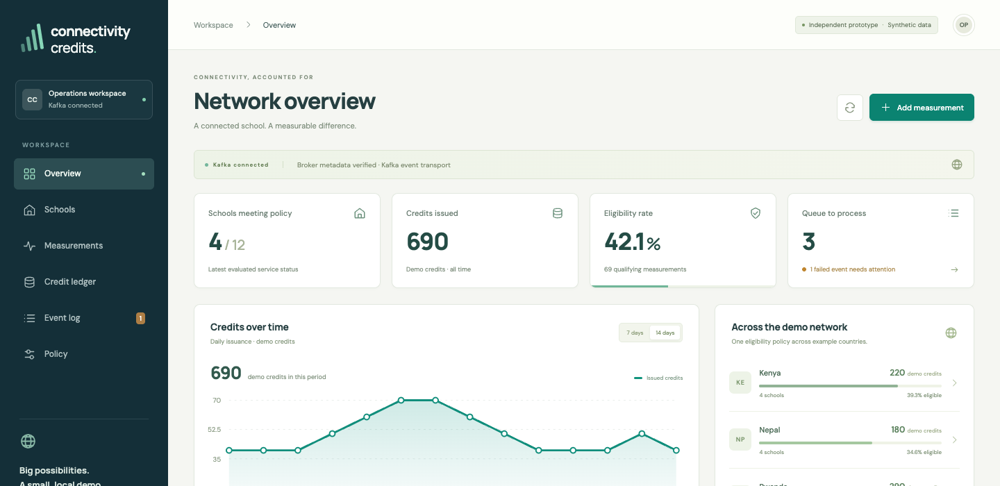

# Connectivity Credits prototype

A working backend and operations console that turns synthetic school internet measurements into auditable demo credits. Built as an independent work sample for the Connectivity Credits backend consultancy.

**TypeScript · Express · React · PostgreSQL · Apache Kafka**



Start with the [five-page technical overview](docs/prototype-overview.pdf), then use the walkthrough below to inspect the behavior. [Operations and setup](OPERATIONS.md) contains the full local/Compose instructions. [Validation](VALIDATION.md) distinguishes executed checks from configuration supplied for later execution.

## What to review

1. **Clean batch:** submit readings, inspect five policy checks and find the resulting credit in the ledger.
2. **Duplicate delivery:** deliver the same event repeatedly and verify that one school day receives one issuance.
3. **Worker failure:** inject a failure after a credit insert, verify rollback, then retry successfully.
4. **Policy versioning:** change a threshold and confirm earlier decisions retain their original checks.

Schools, providers, readings and credit amounts are synthetic. Kenya, Nepal and Rwanda are example labels; country does not affect eligibility. Verification is simulated and credits have no monetary value. The project is independent of UNICEF/Giga and is not a production platform or evidence of school connectivity impact.

## Current stack and scope

| Component | Implementation |
| --- | --- |
| API and worker | Node.js 24, TypeScript, Express 5, Zod |
| Interface | React 18, TypeScript, Vite 6 |
| Persistence | PostgreSQL 16 with async `pg`, transactions and unique constraints |
| Events | Real Apache Kafka producers/consumers, durable outbox/inbox and explicit offset handling |
| Delivery | Dockerfile, Compose and GitHub Actions configuration |

A reading is saved with a durable event, published to Kafka, consumed, evaluated against a versioned policy and committed to PostgreSQL with its decision, credit and audit record. Database constraints protect repeated delivery. This is at-least-once event delivery with idempotent effects, not a distributed exactly-once claim.

The default policy requires download at least 20 Mbps, upload at least 5 Mbps, latency at most 100 ms, uptime at least 98%, and simulated verified status. One qualifying school day receives 10 demo credits. Those values are illustrative assumptions.

## Run locally

Use Node.js 22.16+ (24 recommended), npm, Python 3.11+, PostgreSQL 16+ server binaries and curl on macOS/Linux. Python is used by service helpers and independent QA, not by the application backend.

```bash
./scripts/start-kafka.sh
```

Open **http://127.0.0.1:5173**. The launcher starts a separate PostgreSQL cluster on 5433, Kafka on 19092, Express on 3000 and Vite on 5173. Credentials are generated locally into ignored `.data` files; no database or credentials ship with this repository. The first run downloads and verifies the Kafka/Java runtime. Other PostgreSQL instances are left alone.

A Compose alternative is provided in [OPERATIONS.md](OPERATIONS.md#containers). Docker/Compose execution was not verified on the development machine; the native PostgreSQL/Kafka path was exercised locally. Review CI status separately when the workflow runs.

## Validation

The recorded baseline passed 12 native backend checks and 40 independent API/PostgreSQL/Kafka tests. The latest country-label revision passed 14 focused backend checks, two independent API checks and all nine desktop/mobile browser groups. The latter reported zero browser/console/resource errors. These counts describe separate runs; they are not added together as unique test cases.

```bash
./scripts/test.sh
RUN_KAFKA_TESTS=1 ./scripts/test.sh -q
BROWSER_TRANSPORT=kafka ./scripts/browser.sh
```

For real-broker checks, start Kafka first with `./scripts/kafka-local.sh start`. Tests use disposable PostgreSQL schemas. Detailed commands and evidence are in [VALIDATION.md](VALIDATION.md).

## Source map

- `server/src/`: API, data model, policy logic, outbox and Kafka worker.
- `frontend/src/`: six-tab review console and operator controls.
- `tests/` and `server/tests/`: independent and native validation.
- `scripts/`: local lifecycle, test and browser helpers.
- `docs/prototype-overview.pdf`: plain-language explanation and technical specification.
- `artifacts/`: synthetic screenshots, CSV and test reports.

## Before production

The prototype has one Kafka partition/replica and deliberately simple worker coordination. A production implementation needs agreed data contracts and policy, real measurement/verification adapters, application authentication and authorization, monitoring, backup/recovery checks, load testing and deployment validation. Value transfer and Web3 integrations are not implemented.

Author: [Ankit Pasayat](https://ankitpasayat.com).
